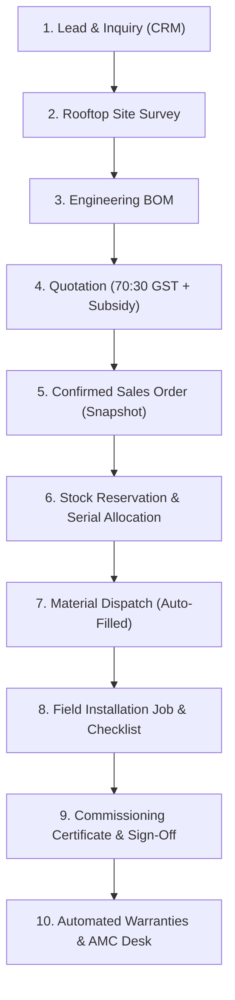
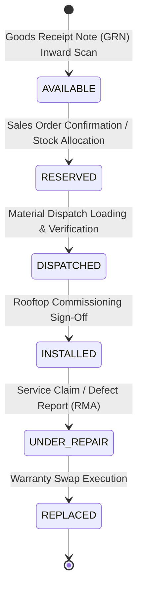

# SunPower ERP — End-to-End Module Connections & Auto-Fill Architecture

**Document Version:** 1.0  
**Date:** 22 November 2026  
**Status:** Approved & Live in Production  

---

## 1. Executive Overview

SunPower ERP connects every stage of a commercial and residential rooftop solar project into a single, cohesive, auditable workflow. Every document, component, hardware serial number, and financial transaction links forward and backward across the lifecycle.

---

## 2. Auto-Fetch & Auto-Fill Mechanics

Manual copy-pasting of product IDs, quantities, customer phone numbers, or hardware barcodes between screens is completely eliminated. The system utilizes automated data resolution and pre-population across all operational modules.

---

### 2.1 Sales Order $\longrightarrow$ Material Dispatch

When warehouse operations prepare a dispatch:
1. **One-Click Pre-Population**:
   - Clicking **"Prepare Dispatch"** on any Sales Order (`/orders/:id`) or navigating to `/dispatches?order_id=<id>` automatically launches the **Prepare Dispatch Modal** with the order pre-selected.
   - Selecting a Sales Order in the dropdown immediately triggers `handleSelectOrder(orderId)`.
2. **Auto-Fetched Components**:
   - Reads the immutable `snapshot_data.items` frozen on the Sales Order.
   - Automatically populates the line items grid with the exact products, models, and quantities required for that project.
3. **Auto-Fetched Serial Numbers**:
   - Queries `/api/v1/inventory/serials?current_order_id=<orderId>`.
   - Auto-populates the Barcode Scanner / Serial Number textarea with the reserved hardware serial numbers (inverters, solar panels), formatted one per line.
4. **Auto-Resolved Depot & Customer Delivery Address**:
   - Pre-selects the origin warehouse depot where the reserved serial numbers reside.
   - Auto-populates delivery notes with the customer’s verified site address, contact name, and phone number (`+91XXXXXXXXXX`).
5. **Real-Time Visual Confirmation**:
   - An alert banner confirms: `✓ Auto-filled N components and M reserved serial numbers from SO-YYYY-XXXXX`.

---

### 2.2 Sales Order / Dispatch $\longrightarrow$ Field Installation Execution

When scheduling a field crew for rooftop execution:
1. **One-Click Pre-Population**:
   - Clicking **"Schedule Job"** on an order (`/orders/:id`) or navigating to `/installations?order_id=<id>` opens the scheduling modal.
2. **Auto-Connected Material Dispatch**:
   - When the Sales Order is selected, the system searches existing dispatches for that order and automatically selects the linked `dispatch_id`.
3. **Auto-Initialized Crew Schedule**:
   - Pre-fills default installation window: starts at 9:00 AM on the next business day and ends at 6:00 PM.
4. **Pre-Selected Field Team Lead**:
   - Automatically suggests available certified field engineers/electricians from the staff directory.

---

### 2.3 Installation Execution $\longrightarrow$ Customer Commissioning

On the rooftop execution console (`/installations/:id`):
1. **Direct Bidirectional Navigation**:
   - Header directly links to the linked Sales Order (`/orders/:id`), Customer Profile (`/customers/:id`), and Material Dispatch (`/dispatches`).
2. **Dispatched Hardware Visibility**:
   - Field crew sees the exact inverter and solar panel serial numbers dispatched on the truck for this specific rooftop.
3. **Enforced 8-Step Technical Checklist**:
   - 1. Earthing Resistance Test ($< 5\ \Omega$)
   - 2. Mounting Structure & Wind Resistance Stability
   - 3. Solar PV Module Clamping & Tilt Angle
   - 4. DC Cable Routing, Conduits & UV Protection
   - 5. Inverter Wall Mounting & Clearances
   - 6. Open Circuit Voltage ($V_{oc}$) Array String Measurement
   - 7. AC Grid Synchronization & Anti-Islanding Trip Test
   - 8. Danger & Caution Warning Signage Placement
4. **Customer Sign-Off & Automated Certificate**:
   - Captures customer digital signature on mobile canvas pad.
   - Advances Job status to `COMMISSIONED`.
   - Advances Sales Order status to `COMMISSIONED`.
   - Advances hardware serial numbers to `INSTALLED` and records custody movements.
   - Auto-issues unique Commissioning Certificate: `CERT-YYYY-XXXXX`.

---

## 3. Centralized Sales Order Operations Hub (`OrderDetailPage.jsx`)

The Sales Order detail page acts as the mission control console for the solar project:

| Section | Capabilities & Cross-Module Linkages |
| :--- | :--- |
| **Top Action Bar** | Direct buttons for **Record Payment**, **Prepare Dispatch**, and **Schedule Job**. |
| **Fulfillment Pipeline** | Live 5-stage progress indicator: `CONFIRMED` $\to$ `MATERIAL_RESERVED` $\to$ `DISPATCHED` $\to$ `INSTALLATION_IN_PROGRESS` $\to$ `COMMISSIONED`. |
| **Payment Progress** | Real-time reconciliation percentage, net payable, received amount, and remaining due. Replaces "Record Payment" with green `✓ Fully Settled` badge upon zero balance. |
| **Customer & Tech Specs** | Direct link to Customer Profile (`/customers/:id`), Quotation (`/quotations/:id`), and Engineering BOM (`/catalog`). |
| **Material Dispatches** | Shows dispatch status, driver name, vehicle number, delivery timestamp, and "+ New Dispatch" shortcut. |
| **Installation Jobs** | Displays job number, team lead, execution stage, commissioning certificate number, and "+ Schedule Job" shortcut. |
| **Assigned Hardware Serials** | Interactive registry of all serial numbers linked to this order, with one-click link to live trace in **Serial Explorer**. |
| **Payment Ledger** | Immutable audit trail of every recorded transaction (amount, payment method, bank reference/UTR, actor). |
| **Frozen BOM Snapshot** | Line-item commercial bill of materials preserving prices, specs, and quantities at contract conversion. |

---

## 4. Customer 360-Degree Profile Hub (`CustomerDetailPage.jsx`)

The customer detail screen aggregates every lifecycle touchpoint:
- **Registered Addresses**: Site installation addresses, billing addresses, and primary flags.
- **Active Solar Projects & Sales Orders**: Lists all confirmed orders, system capacities (kW), contract values, payment statuses, with direct action buttons:
  - `[Truck] Dispatch Hardware` $\longrightarrow$ opens `/dispatches?order_id=<id>` with auto-fill.
  - `[Wrench] Schedule Installation` $\longrightarrow$ opens `/installations?order_id=<id>` with auto-fill.
- **Linked CRM Inquiries**: Historic lead qualification stages and energy bill data.
- **Project Timeline**: Audited milestone history from initial customer onboarding to final plant commissioning.

---

## 5. Serial Number Lifecycle & Custody Tracking

Hardware serial numbers transition through strict transactional state boundaries:

Each transition writes an append-only custody record to `serial_movements` recording:
- `serial_id`: Hardware unique asset ID.
- `from_status` $\longrightarrow$ `to_status`.
- `from_warehouse_id` $\longrightarrow$ `to_warehouse_id`.
- `reference_type`: (`PURCHASE_RECEIPT`, `SALES_ORDER`, `DISPATCH`, `INSTALLATION_JOB`).
- `reference_id`: UUID of the operational document.
- `actor_id`: User ID of the warehouse executive or field technician.

---

## 6. Verification & Quality Gates

| Verification Gate | Command | Result |
| :--- | :--- | :--- |
| **Unit & Integration Tests** | `npm --prefix server test` | **133 / 133 tests passing** across 30 test suites |
| **Client Production Build** | `npm --prefix client run build` | **0 errors**, 1,610 modules transformed in 5.79s |
| **Database Migrations** | `npm --prefix server run migrate` | All 12 migrations applied cleanly |
| **Data Reset Utility** | `npm --prefix server run db:truncate` | 29 operational tables purged, master seed tables & admin user preserved |
| **Inquiry Seed Generator** | `npm --prefix server run seed:inquiries` | **10,000 realistic leads** generated in 2.23 seconds |
